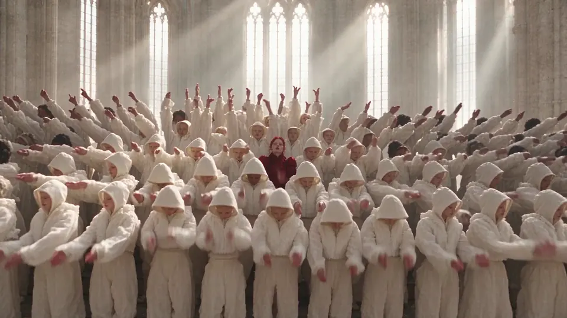

<h1 align="center">Viral Video Cloner</h1>

<p align="center"><b>Recreate any viral video with your AI agent.</b><br>
Keep the moves and camera. Swap in your face, product or world.</p>

<p align="center">
  <a href="https://chatcut.io/viralvideocloner?utm_source=github&utm_medium=readme&utm_campaign=oss_viral_cloner&utm_content=nav"><b>Website</b></a>
  &nbsp;&bull;&nbsp;
  <a href="#what-you-can-change"><b>Examples</b></a>
  &nbsp;&bull;&nbsp;
  <a href="docs/how-it-works.md"><b>How it works</b></a>
  &nbsp;&bull;&nbsp;
  <a href="README.zh-CN.md"><b>简体中文</b></a>
</p>

<p align="center">
  
  
  <a href="LICENSE"></a>
  <a href="https://discord.com/invite/sMjQPvwZTT"></a>
</p>

<p align="center">
  
</p>
<p align="center"><sub>One crowd dance recreated as three worlds: a white gothic court, a red-feather revue and a 1930s aquacade. <a href="https://chatcut.io/viralvideocloner?utm_source=github&utm_medium=readme&utm_campaign=oss_viral_cloner&utm_content=hero">Watch the full video</a>.</sub></p>

## Install

```bash
npx skills add ChatCut-Inc/viral-video-cloner -g
```

## Start in three steps

1. **Pick a video to recreate.** A link or a file works.
2. **Send your request to your AI agent.** It sets up ChatCut, then asks for the video and your photos or footage.
3. **AI makes your version.** Edit or export the result.

```text
Recreate this dance with me in the lead: https://www.tiktok.com/@creator/video/123  (attach me.jpg)
```

On first use, the skill sets up [ChatCut Desktop](https://chatcut.io/viralvideocloner?utm_source=github&utm_medium=readme&utm_campaign=oss_viral_cloner&utm_content=install) (free, macOS and Windows) and connects it to your agent. If sign-in is needed, your agent guides you through it and continues in the same conversation. If tools or Skills have not loaded, it follows your agent app's requirements to refresh, restart and resume, or start a new conversation. When a new conversation is needed, it gives you a complete prompt to copy, carrying your request, media and setup progress forward. Recreations need a ChatCut membership. Before anything renders, your agent tells you how long the result will be and roughly how many credits it costs. Nothing starts until you say go.

## What it's for

**Viral, UGC and TV ads, recreated.** Take content that already works and make it yours.

| Viral trends | UGC ads | TV commercials | Product showcase |
| --- | --- | --- | --- |
| <video src="UPLOAD:usecase-viral" controls muted width="200"></video> | <video src="UPLOAD:usecase-ugc" controls muted width="200"></video> | <video src="UPLOAD:usecase-tvc" controls muted width="200"></video> | <video src="UPLOAD:usecase-fashion" controls muted width="200"></video> |
| Put yourself into the dance or meme everyone is making. | The same selfie review, with your product in hand. | The same cinematic shot, starring your product. | One try-on video, dressed in your new collection. |

## What you can change

### Motion transfer

The movement and camera stay exactly as filmed. Everything performing it is yours.

<video src="UPLOAD:truck-compare" controls muted></video>

A man on a camp chair in a golden field becomes a woman in white on a snowy plain at sunrise, and the black pickup becomes an orange rally truck. `16:9 · 8 s · 1080p · ≈21 credits` · [plan](examples/truck-jump-snowfield)

### Object swap

Say what should be different: a person, a product, an outfit. The rest of the shot stays untouched.

<video src="UPLOAD:toycar-compare" controls muted></video>

A model car on a train windowsill grows into a real car in the tunnel. `16:9 · 8 s · 720p · ≈8.5 credits` · [plan](examples/toy-car-train-tunnel)

<video src="UPLOAD:swap-strip" controls muted></video>

A creator's tumbler becomes your moka pot, a poodle barista becomes a British shorthair, and a canister on a back seat becomes a gift box. `9:16 · 8 s · 720p · ≈9 credits each` · plans: [moka pot](examples/ugc-moka-pot), [cat barista and gift box](examples/showcase)

### Batch

One UGC ad, four creators in four settings. Same product, same pitch.

<video src="UPLOAD:batch-strip" controls muted></video>

`9:16 · 8 s each · 4 versions` · [plans](examples/ugc-four-creators)

## Showcase

**Turn one video into any reality.** [Seven short recreations](examples/showcase) and more examples, each with the exact plan, are in [examples/](examples/README.md).

## How it works

1. **Your agent studies the source.** It reads every shot and cut and writes a plan: who plays which role, what to swap, what must stay.
2. **You confirm length and cost.** Recreations run from 4 to 30 seconds.
3. **ChatCut renders it.** The source's motion guides the new video, so moves, camera work and cut points follow the original. The source audio is kept.
4. **The result lands in a ChatCut project,** ready to edit further or export.

Have your own footage instead? The agent can also cut it to the source's rhythm, captions and effects. Details: [docs/how-it-works.md](docs/how-it-works.md).

## Pricing

- The skill is free and open source. ChatCut Desktop is free to download.
- Recreations are generated in the cloud and need a ChatCut membership; they use the membership's credits ([pricing](https://chatcut.io/pricing?utm_source=github&utm_medium=readme&utm_campaign=oss_viral_cloner&utm_content=pricing)). As a guide: 8 seconds at 720p is about 10 credits, at 1080p about 26.
- Your agent quotes the length and estimated credits before every render. See [docs/pricing.md](docs/pricing.md).

## Use it responsibly

- **Only recast people who agreed.** Yourself, people who gave you permission, or characters you created.
- **No public figures.** Don't recreate celebrities, politicians or other real people you don't have rights to.
- **Mind the source.** A recreation keeps the source audio and follows its choreography and shots. If you publish it, make sure you may use them, or replace the audio.
- **Label AI content** where your platform asks for it, and never use a recreation to fake an endorsement.

Full policy: [docs/responsible-use.md](docs/responsible-use.md). Report misuse to team@chatcut.io.

## FAQ

**What is Viral Video Cloner?** A ChatCut skill that recreates a video you like. Give your AI agent the original video and your photos or footage. It keeps the moves and camera while putting in your person, product or scene.

**Which AI agents can I use?** AI agents that run on your computer, such as Claude Code and Codex (macOS 13+ or Windows x64). Browser-only chats and cloud sandboxes can't reach ChatCut Desktop. The first time, your agent sets up ChatCut for you.

**Can I use it without an AI agent?** Yes. Download [ChatCut Desktop](https://chatcut.io/viralvideocloner?utm_source=github&utm_medium=readme&utm_campaign=oss_viral_cloner&utm_content=faq), open Viral Video Cloner in Skills, and add the original video and your photos or footage.

**What's the difference between motion transfer and object swap?** Motion transfer keeps the moves, camera and timing and rebuilds the cast and scene from your photos. Object swap keeps the whole shot and changes only the person, product or outfit you name.

**Do I have to choose a mode?** No. Say what you want to change and your AI agent picks the mode.

**What videos can I use?** A video link or a local file. Each recreation covers 4 to 30 seconds; for a longer video, your agent picks the part with the fullest action and tells you.

**Do I need video editing experience?** No. Say what you want to change; your AI agent handles the rest.

**How many photos can I add?** Up to 6 per recreation: people, products, outfits or places.

**How much does it cost?** Recreations use ChatCut credits. Before generating, you see how long the recreation will be and roughly how many credits it costs, and nothing starts until you confirm.

**Does it keep the original audio?** Yes. The recreation keeps the source audio. If the source has no sound, it keeps the sound the model generates.

**Where does the finished video go?** Into a ChatCut project, where you can keep editing it or export it.

**How is it different from other recreation tools?** You ask in plain words inside Claude Code or Codex: no ComfyUI graph and no NVIDIA GPU, because rendering runs in the cloud. The agent writes a shot-by-shot plan first, so cut points line up with the source, and the result opens in an editor where you can keep cutting.

## Repository

```text
skills/viral-video-cloner/   the skill (also linked from .claude/skills and .agents/skills)
examples/                    every example: plan, reference images, cost, what changed
docs/                        how it works, pricing, responsible use
```

## Contributing

Made something good with it? [Share your recreation](https://github.com/ChatCut-Inc/viral-video-cloner/issues/new?template=showcase.yml): the best ones join the examples. Bug reports and skill improvements are welcome too. See [CONTRIBUTING.md](CONTRIBUTING.md).

## License

The skill, plans and docs are released under the [Apache License 2.0](LICENSE). Example media is licensed separately, mostly under CC BY 4.0; see [examples/MEDIA-LICENSE.md](examples/MEDIA-LICENSE.md). ChatCut and Viral Video Cloner are trademarks of ChatCut; see [TRADEMARK.md](TRADEMARK.md).

<p align="center"><sub>Built by <a href="https://chatcut.io/?utm_source=github&utm_medium=readme&utm_campaign=oss_viral_cloner&utm_content=footer">ChatCut</a>, the AI video editor your agent can drive.</sub></p>
