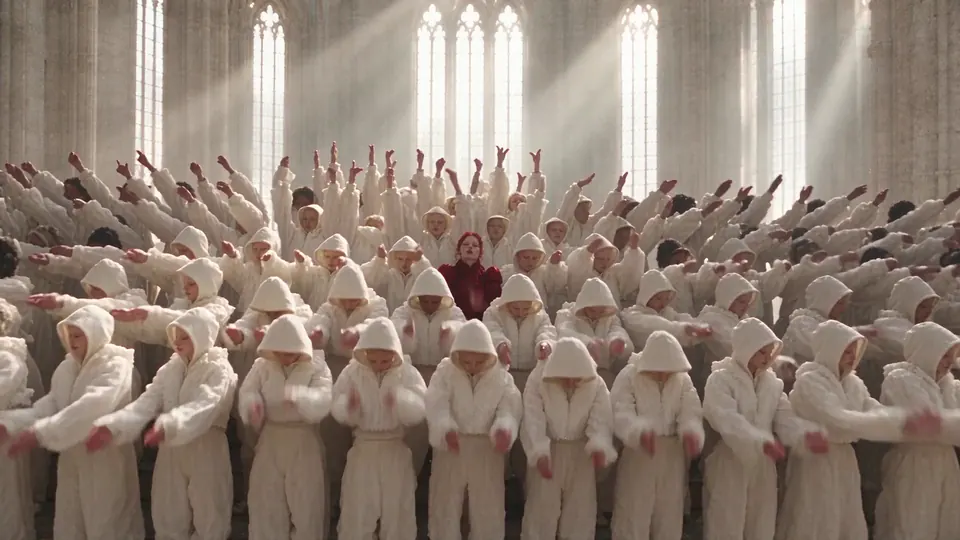

<h1 align="center">爆款复刻 · Viral Video Cloner</h1>

<p align="center"><b>让你的 AI agent 复刻爆款视频。</b><br>
一条视频，一张照片，不用重拍。<br>
动作、运镜、切点都不变，人、商品和场景换成你的。</p>

<p align="center">
  <a href="https://chatcut.io/zh/viralvideocloner?utm_source=github&utm_medium=readme&utm_campaign=oss_viral_cloner&utm_content=nav_zh"><b>官网</b></a>
  &nbsp;&bull;&nbsp;
  <a href="#示例"><b>示例</b></a>
  &nbsp;&bull;&nbsp;
  <a href="docs/how-it-works.md"><b>原理</b></a>
  &nbsp;&bull;&nbsp;
  <a href="README.md"><b>English</b></a>
</p>

<p align="center">
  
  
  <a href="LICENSE"></a>
</p>

<p align="center">
  
</p>
<p align="center"><sub>左：原片。右：每个世界只给了一张人物参考图。滑行、起跳、擦杆和运镜都和原片一致。<a href="examples/skate-one-take-two-worlds">看规划文件</a>。</sub></p>

**Hypit 克隆的是剪辑流程：脚本、字幕、B-roll。爆款复刻保留的是画面本身。** 原片的动作、运镜和每个切点都不变，人、商品和场景换成你的。

## 安装

```bash
npx skills add ChatCut-Inc/viral-video-cloner -g
```

然后直接跟你的 agent 说：

```text
用我当滑板主角，复刻这条视频：<视频链接或本地文件>（附上 me.jpg）
```

第一次用时，技能会帮你装好 [ChatCut 桌面端](https://chatcut.io/zh/viralvideocloner?utm_source=github&utm_medium=readme&utm_campaign=oss_viral_cloner&utm_content=install_zh)（免费，支持 macOS 和 Windows），并接到你的 agent 上。第一次装好后，agent 会请你先登录 ChatCut，再开一个新对话发一遍，因为 agent 只在对话开始时加载工具。复刻需要 ChatCut 会员。开始生成前，agent 会先告诉你成片多长、大约花多少积分，你同意了才开始。

## 示例

### 动作迁移：换人、换世界，特技照原样

<video src="UPLOAD:truck-compare" controls muted></video>

金色荒野里坐在折叠椅上的男人，换成雪原日出里的白衣女生；黑色皮卡换成橙色拉力皮卡。飞跃、落地和运镜都没变。`16:9 · 8 秒 · 1080p · 约 21 积分` · [规划](examples/truck-jump-snowfield)

### 局部替换：只换一样东西，其余像素不动

<video src="UPLOAD:toycar-compare" controls muted></video>

火车窗台上的模型车，进隧道后变成真车。只换了车，窗台、森林和隧道灯光都是原片。`16:9 · 8 秒 · 720p · 约 8.5 积分` · [规划](examples/toy-car-train-tunnel)

<video src="UPLOAD:swap-strip" controls muted></video>

每条都从原片擦到复刻。博主手里的吸管杯换成你的摩卡壶，她的脸、台词和房间都不变；贵宾犬咖啡师换成英短猫；后座上的塑料桶换成礼盒。`9:16 · 8 秒 · 720p · 每条约 9 积分` · 规划：[摩卡壶](examples/ugc-moka-pot)、[猫咖啡师和礼盒](examples/showcase)

### 批量出片：一条广告，多位博主

<video src="UPLOAD:batch-strip" controls muted></video>

同一条 UGC 广告，换成四位博主、四个场景：咖啡馆、车里、天台、书房。同一个杯子，同一套话术，同样的节奏。`9:16 · 每条 8 秒 · 4 个版本` · [规划](examples/ugc-four-creators)

**更多示例**：群舞换三个世界、运动服品牌片，以及 7 条短复刻（猫咖啡师、巨人的靴子、吊扇换装……）都在 [examples/](examples/README.md)。

## 适合做什么

- **广告**：跑量好的广告，逐镜头复刻成你的产品。节奏、运镜不变，主角换成你的商品。
- **UGC 种草**：保留博主的表达，把商品换成你的；或者一套脚本，批量换成多位博主、多个场景。
- **编舞**：把你自己、你的吉祥物或虚拟角色放进正火的舞蹈，动作和切点照原版。
- **品牌片**：把一个电影感镜头搬进你的品牌世界：你的配色、你的场地、你的人。

## 怎么做到的

1. **agent 先看片**：读出每个镜头和切点，写一份规划：谁演哪个角色、换什么、什么必须保留。
2. **你确认时长和费用**：每次复刻 4–30 秒。
3. **ChatCut 生成**：用原片的动作引导新画面，动作、运镜和切点都跟着原片走，原声保留。
4. **成片进 ChatCut 项目**：可以接着剪，也可以直接导出。

三种做法：

| 做法 | 换掉什么 | 保留什么 |
| --- | --- | --- |
| **动作迁移** | 人、场景和画风，按你的参考图重新生成 | 动作、运镜和节奏 |
| **局部替换** | 只换你点名的人、商品或衣服 | 画面里其余的每个像素 |
| **批量出片** | 每个版本换一组人或商品 | 镜头、话术和节奏 |

手上有自己的素材？agent 也可以照原片的节奏、字幕和特效来剪你的素材。详见 [docs/how-it-works.md](docs/how-it-works.md)。

## 怎么收费

- 技能免费、开源；ChatCut 桌面端免费下载。
- 复刻在云端生成，需要 ChatCut 会员，用会员积分支付（[价格](https://chatcut.io/zh/pricing?utm_source=github&utm_medium=readme&utm_campaign=oss_viral_cloner&utm_content=pricing_zh)）。参考：8 秒 720p 约 9 积分，1080p 约 21 积分。
- 每次生成前，agent 都会先报时长和预估积分。详见 [docs/pricing.md](docs/pricing.md)。

## 安全与授权

- **只换得到同意的人**：你自己、授权给你的人，或你自己创作的角色。
- **不做公众人物**：明星、政要，以及你没有权利使用的真人，都不要复刻。
- **注意原片权利**：复刻会保留原片的声音，也沿用它的编舞和镜头。要发布的话，先确认你有权使用，或者换掉原声。
- **按平台要求标注 AI 生成**，不要用复刻伪造代言。

完整说明：[docs/responsible-use.md](docs/responsible-use.md)。发现滥用请发邮件到 team@chatcut.io。

## 常见问题

**支持哪些 agent？** 在你电脑上运行的 Claude Code 和 Codex（macOS 13 及以上或 Windows x64）。纯网页聊天和云端沙箱连不到 ChatCut 桌面端。

**原片可以用什么？** 视频链接或本地文件都行。每次复刻 4–30 秒；更长的视频，agent 会挑动作最完整的一段，并告诉你选了哪段。

**能放几张参考图？** 每次最多 6 张：人、商品、衣服或地点。

**和其他复刻工具有什么不同？** 在 Claude Code 或 Codex 里用一句话说清要换什么就行，不用搭 ComfyUI，也不需要 NVIDIA 显卡，生成在云端跑。agent 会先写逐镜头的规划，切点和原片对得上；成片直接进剪辑器，还能接着剪。

**没有 agent 怎么办？** 下载 [ChatCut 桌面端](https://chatcut.io/zh/viralvideocloner?utm_source=github&utm_medium=readme&utm_campaign=oss_viral_cloner&utm_content=faq_zh)，在「技能」里打开爆款复刻，放进原片和你的照片就行。

## 仓库结构

```text
skills/viral-video-cloner/   技能本体（.claude/skills 和 .agents/skills 里有链接）
examples/                    每个示例：规划、参考图说明、费用、换了什么
docs/                        原理、计费、安全与授权
```

## 参与贡献

用它做出了好东西？[分享你的复刻](https://github.com/ChatCut-Inc/viral-video-cloner/issues/new?template=showcase.yml)，好的作品会收进示例。也欢迎报 bug、改进技能，见 [CONTRIBUTING.md](CONTRIBUTING.md)。

## 许可

技能、规划和文档以 [Apache License 2.0](LICENSE) 发布。示例素材单独授权，大部分是 CC BY 4.0，见 [examples/MEDIA-LICENSE.md](examples/MEDIA-LICENSE.md)。ChatCut 和 Viral Video Cloner 是 ChatCut 的商标，见 [TRADEMARK.md](TRADEMARK.md)。

<p align="center"><sub>由 <a href="https://chatcut.io/zh/?utm_source=github&utm_medium=readme&utm_campaign=oss_viral_cloner&utm_content=footer_zh">ChatCut</a> 出品：能让 agent 直接上手剪辑的 AI 视频编辑器。</sub></p>
